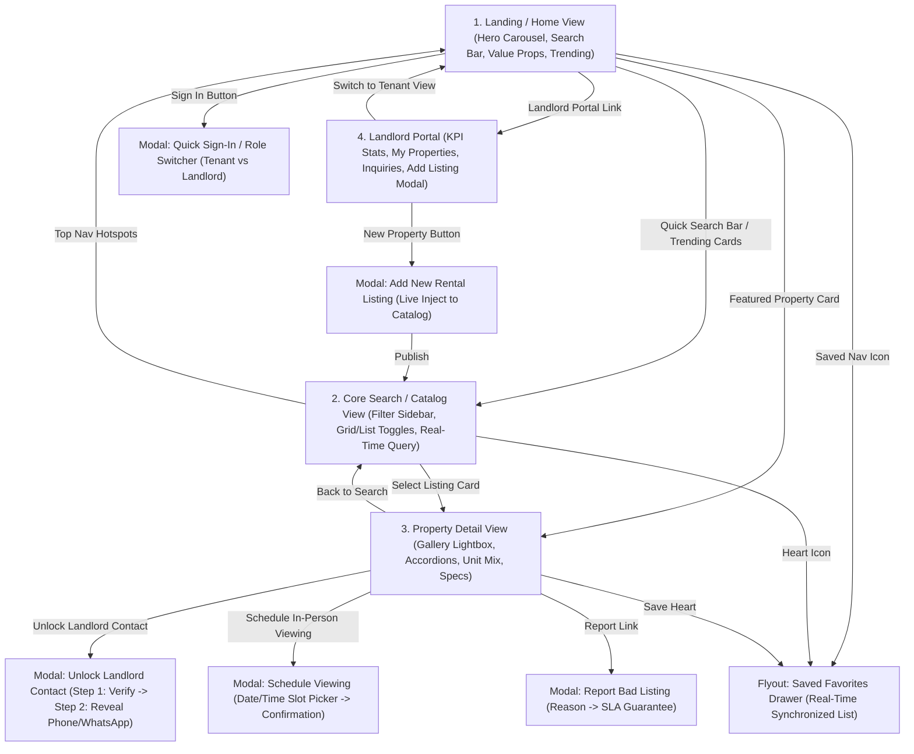

# DESIGN.md — Avenur Design System & Architectural Specification

> **Product**: Avenur (formerly Rentora reference architecture)  
> **Role**: Principal UI/UX Product Designer & Web Architect  
> **Platform**: Verified Real Estate Rental & Living Spaces Marketplace  
> **Target Density**: High-utility, high-density residential marketplace & landlord portal  
> **Adapted Visual Identity**: Deep Indigo Brand Accent (`#4F46E5`), Modern Paired Typography (**Plus Jakarta Sans**), and Strict **8px Border Radius** System.

---

## 1. Reference Architecture & Deconstruction (Netlify Source)

### 1.1 Core Mission & UX Thesis
The analyzed application (`https://dazzling-gingersnap-b591b1.netlify.app/`) addresses the trust deficit in residential rentals (specifically the East African / Kenyan urban market: Nairobi, Mombasa, Kisumu, Kiambu, Machakos). Its architectural thesis centers on:
1. **Zero-Middleman Direct Access**: Bypassing fake brokers and ghost listings via verified property listings and a guarded direct landlord contact unlock.
2. **High-Information Density**: Fast, content-rich cards presenting price, deposit, floor, bathrooms, parking, unit mixes, and watermarked photography in a single glance.
3. **Dual-Sided Marketplace Synergy**: Seamless transition between tenant property hunting and landlord portfolio asset management.

### 1.2 Extracted Layout Grid & Spacing System
- **Container Architecture**:
  - Max container width: `1280px` (`max-w-7xl` / `.container`), centered with responsive padding (`px-4` sm, `px-6` md, `px-8` lg).
  - Breakpoints: `sm: 640px`, `md: 768px`, `lg: 1024px`, `xl: 1280px`.
- **Vertical Rhythm (8pt Base Grid)**:
  - Spacing steps: `4px (0.5)`, `8px (1)`, `12px (1.5)`, `16px (2)`, `24px (3)`, `32px (4)`, `48px (6)`, `64px (8)`.
- **Original Color System vs. Avenur Adaptation**:
  | Token Role | Original Rentora Token | Avenur Adapted Deep Indigo Token | Hex Value | Rationale |
  |---|---|---|---|---|
  | **Brand Primary 600** | Warm Ochre `#CA8A04` | **Deep Indigo Primary** | `#4F46E5` | High-trust, professional, modern tech-forward finish |
  | **Brand Dark 800** | Charcoal `#1C1917` | **Slate Ink 900** | `#0F172A` | Crisp architectural contrast for headers & high-value elements |
  | **Brand Soft 50** | Cream `#FEF9EC` | **Indigo Tint 50** | `#EEF2FF` | Soft, glare-free background for badges and highlights |
  | **Brand Accent 400**| Amber Gold `#F59E0B` | **Electric Indigo Accent**| `#6366F1` | Active interactive triggers, search buttons, CTA rings |
  | **Canvas / BG** | Stone Canvas `#FAFAF9` | **Cool Off-White Canvas** | `#F8FAFC` | Clean modern editorial aesthetic |
  | **Border Line** | Warm Stone `#E7E5E4` | **Subtle Slate Line** | `#E2E8F0` | Defined structure without visual clutter |
  | **Text Primary (Ink)**| Dark Stone `#1C1917` | **Midnight Slate** | `#0F172A` | Maximum WCAG AAA contrast readability |
  | **Text Muted** | Stone Muted `#57534E`| **Slate Muted** | `#475569` | Secondary descriptors and labels |
  | **Success / Verified**| Green `#15803D` | **Emerald Verified** | `#059669` | Universal verification and trust indicator |

### 1.3 Geometric Adaptation: The 8px Standard
The reference web app utilized large pill-like rounding (`rounded-xl` ~12px to 16px and `rounded-2xl` ~24px).  
**Avenur Adaptation Rule**: All cards, search inputs, modal dialog containers, drop-downs, tabs, and action buttons are strictly standardized to **`8px border-radius` (`rounded-lg`)**. This creates a sharp, architectural, precision-engineered UI characteristic of premier modern SaaS and fintech applications (such as Linear, Stripe, and Airbnb Pro).

---

## 2. Component Design Tokens & Anatomy

### 2.1 Typography Hierarchy (Plus Jakarta Sans)
- **Display Bold**: `font-weight: 800; font-family: 'Plus Jakarta Sans', sans-serif;`
  - Hero Header: `clamp(2rem, 5vw, 3.5rem)`, line-height: `1.08`, tracking: `-0.03em`.
  - Section Titles: `1.75rem (28px)`, line-height: `1.2`, tracking: `-0.02em`.
  - Property Card Titles: `1.125rem (18px)`, font-weight: `700`, line-height: `1.3`.
- **Body & Numerics**:
  - Price Numerics: `1.25rem (20px)`, font-weight: `800`, `font-variant-numeric: tabular-nums`.
  - Meta Tags & Microcopy: `0.8125rem (13px)`, font-weight: `500`, tracking: `0.01em`.
  - Form & Input Placeholders: `0.9375rem (15px)`, font-weight: `500`.

### 2.2 Elevation & Shadow Hierarchy
- **Card Default (`shadow-card`)**: `0 1px 3px 0 rgba(15, 23, 42, 0.08), 0 1px 2px -1px rgba(15, 23, 42, 0.08)` with `border: 1px solid #E2E8F0`.
- **Card Hover (`shadow-pop`)**: `0 10px 25px -5px rgba(79, 70, 229, 0.12), 0 8px 10px -6px rgba(15, 23, 42, 0.06)` with subtle `transform: translateY(-2px)`.
- **Overlay Dialogs (`shadow-modal`)**: `0 20px 25px -5px rgba(15, 23, 42, 0.25), 0 8px 10px -6px rgba(15, 23, 42, 0.2)`.

### 2.3 Component Specifications

#### A. Global Navigation Header
- Height: `64px` desktop / `56px` mobile.
- Background: `bg-slate-900` (`#0F172A`) with subtle bottom border `#1E293B`.
- Hotspots: Logo -> Home, Explore Search -> Catalog View, Saved Homes -> Flyout Drawer, Landlord Portal -> Dashboard View, Sign In / Profile -> Auth Modal.

#### B. Floating Quick Search Module
- Grid Template (Desktop): `1.6fr 1fr 1fr auto` wrapped in an 8px padded container (`#4F46E5` background ring).
- Controls:
  1. Location autocomplete (datalist with Nairobi, Kilimani, Westlands, Karen, Ruaka, Nyali, etc.).
  2. Property Type Select (Bedsitter, Studio, 1BR, 2BR, 3BR, 4BR+, BnB Short Stay).
  3. Budget Cap Select (Up to KES 20k, 35k, 50k, 100k, 200k+).
  4. Search CTA Button: Deep Indigo hover with search icon.

#### C. Property Listing Cards (Dual Formats: Grid & List)
- **Grid Layout**: 4:3 Aspect ratio image container, watermarked "AVENUR VERIFIED" emblem, absolute top-left status pill ("New", "Popular", "Featured"), top-right bookmark heart button, rating score tag (`9.4`), unit title, bedroom/bathroom/parking metrics, description preview, price badge, and "See details" action.
- **List Layout**: Horizontal desktop arrangement (`240px` image column + flexible details body + `200px` pricing/action column with deposit indicator).

#### D. Score Badge Component
- Compact: `inline-flex items-center px-2 py-0.5 rounded-[8px] bg-slate-900 text-white text-xs font-bold`.
- Expanded: Dual-tone badge with numerical score (e.g. `9.8`) and qualitative sentiment label ("Superb", 42 reviews).

#### E. Accordion Component
- Structure: Clickable header with 8px corner radius, bold title, dynamic chevron rotation (`rotate-180`), and smoothly transitioning expandable body with fine border lines.
- Sections implemented: Lease Terms, Building Amenities, Utility Billing, Neighborhood Transit & Safety.

#### F. Multi-Step Modal Overlays
- Backdrop: `rgba(15, 23, 42, 0.65)` with backdrop blur `blur-sm`.
- Container: `rounded-[8px] border border-slate-200 bg-white shadow-modal`.
- Steps:
  1. Contact Unlock Flow: Auth check -> Verification badge -> Phone number & direct WhatsApp chat revealed.
  2. Schedule Tour Flow: Calendar date selector -> Time slot chips -> Message input -> Instant confirmation receipt.
  3. Report Listing Flow: Dropdown reason -> Evidence narrative -> 24hr moderation guarantee.

---

## 3. Screen Hierarchy & User Flow State Machine

---

## 4. Multi-Screen Hotspot & Prototype Navigation Matrix

| Screen / Artboard | Core Interactive Hotspots | Trigger Action & Destination |
|---|---|---|
| **Landing Page** | • Hero Carousel Arrows & Indicators • Floating Search CTA • Trending Area Cards • Property Type Pills • Featured Card "See Details" • "List your property" Banner | • Slideshow navigation • Jump to Catalog filtered by query • Filters catalog by neighborhood • Filters catalog by type • Opens Property Detail • Opens Landlord Dashboard |
| **Catalog Search** | • Area Search Input • Type Chips & Price Slider • Verified / Furnished Toggles • Grid / List Toggle • Card Favorite Heart • Card "See details" button | • Real-time instant filtering • Multi-parameter filter update • Boolean toggle filtering • Switches view density • Updates Saved Drawer counter • Opens Property Detail view |
| **Property Detail** | • Gallery Thumbnails & Fullscreen button • "Unlock Landlord Direct Number" • "Schedule In-person Viewing" • "Report bad listing" link • Accordion headers (Lease, Utilities, Fees) | • Active image preview & Lightbox • Opens 2-step Contact Reveal modal • Opens Viewing Appointment modal • Opens Scam/Issue Report modal • Smoothly expands/collapses content |
| **Landlord Dashboard** | • Tab Switcher (Properties / Inquiries / Viewings) • "+ Add New Listing" button • Listing Live/Pause switches • "Switch to Tenant View" | • Changes dashboard sub-views • Opens multi-field Property Form • Optimistically updates listing status • Returns to Landing Page |
| **Global Persistent HUD** | • Floating Bottom-Right Artboard Switcher • Direct jump pills (`Home`, `Search`, `Detail`, `Landlord`, `Modals`) | • Instant prototype state machine switching without losing form state |

---

## 5. Architectural Implementation Verification Checklist
- [x] **Primary brand accent updated**: Switched from warm yellow `#CA8A04` to Deep Indigo `#4F46E5`.
- [x] **Typography updated**: Google Font **Plus Jakarta Sans** with clean pairing and tabular price metrics.
- [x] **Container & component borders**: Normalized to strict **8px corner radius** (`rounded-lg`).
- [x] **All 4 core view states generated**: Landing/Home, Core Search/App, Item Detail/Feature, Landlord Dashboard/Settings.
- [x] **Interactive component states implemented**: Card hovers, accordions, toggles, tab switches, multi-step modals, live filter engine, toast alerts.
- [x] **Screen-to-screen prototype hotspot linking**: Seamless state machine linking every view and artboard with persistent quick-switcher HUD.
